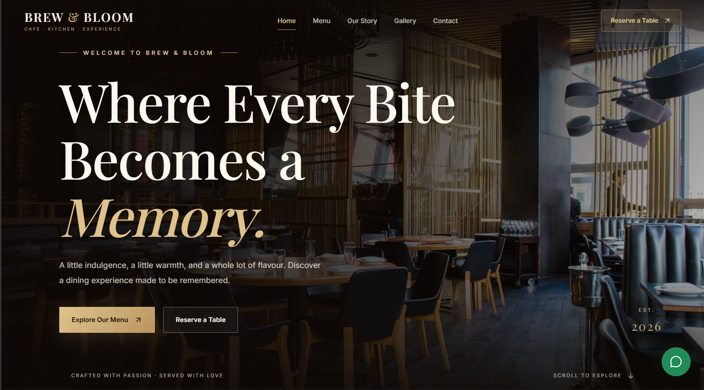
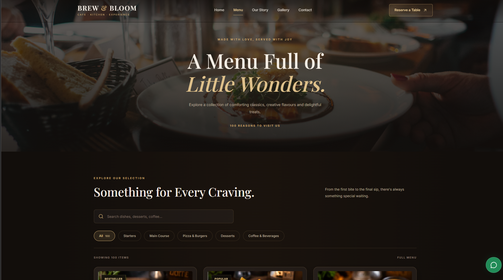
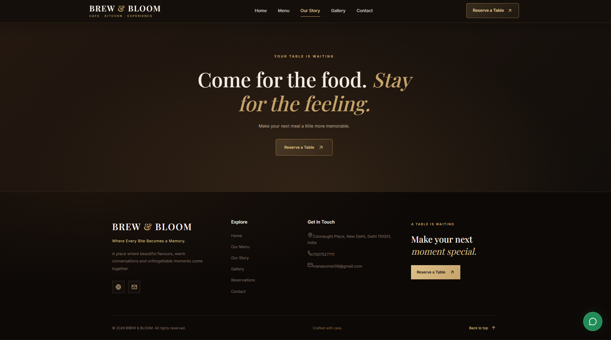
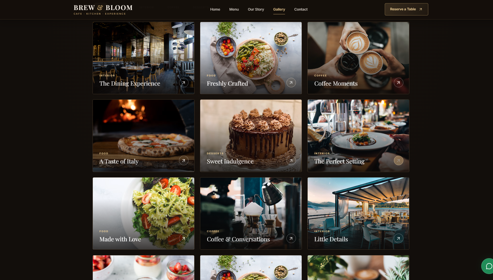
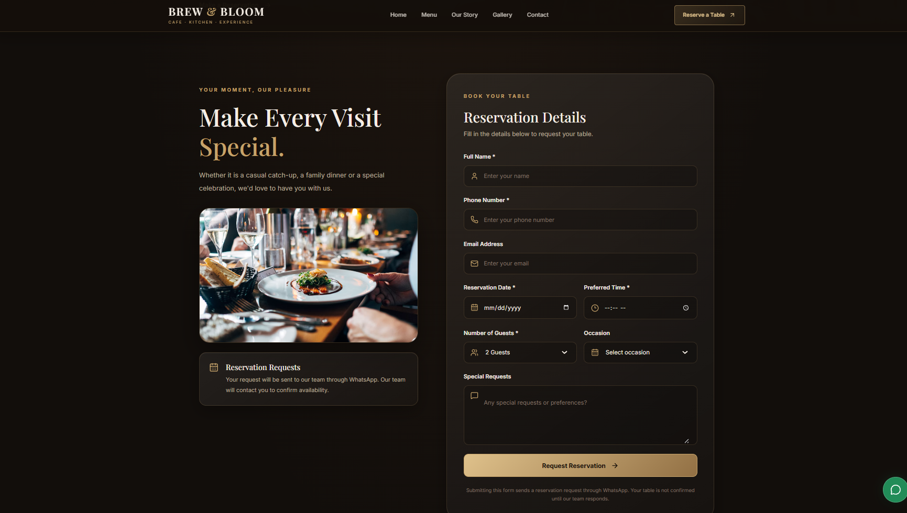
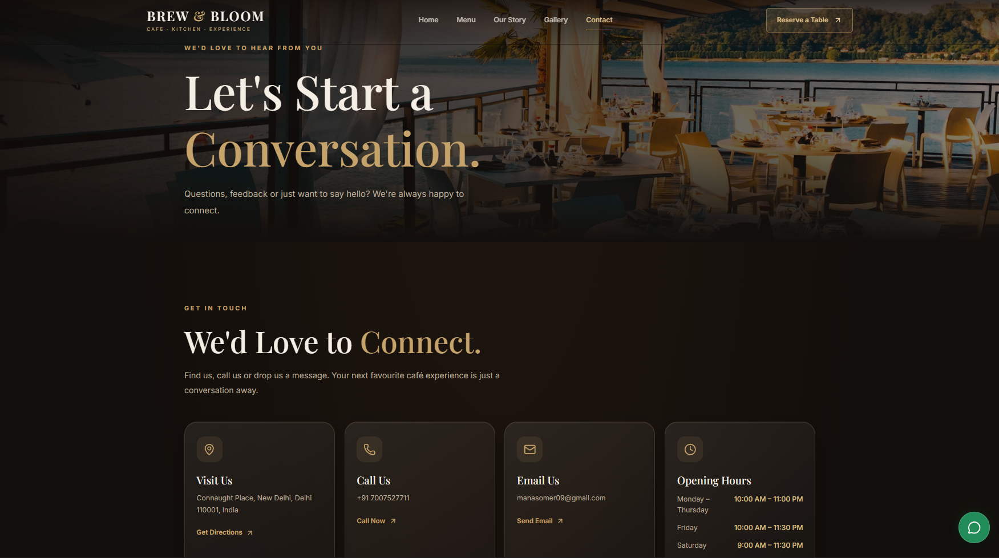
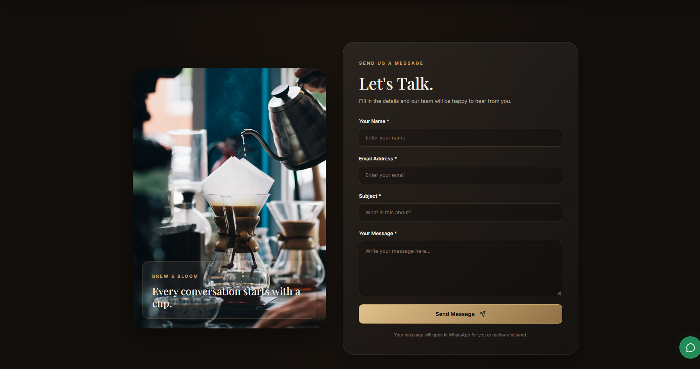
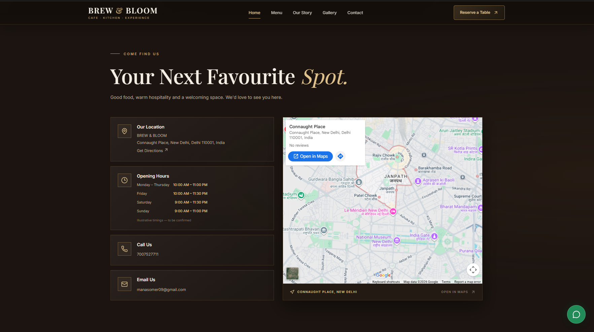

# BREW & BLOOM ☕

### Where Every Bite Becomes a Memory.

A premium, modern restaurant and café website built with React. BREW & BLOOM combines an elegant dark aesthetic, immersive food photography, interactive menu browsing, and convenient reservation and contact experiences.

**🌐 Live Demo:** https://brew-bloom-sage.vercel.app/

**📦 GitHub Repository:** https://github.com/manasomer0902/BREW-BLOOM

---

## 📸 Screenshots

### Home Page


### Menu Page


### About Page


### Gallery


### Reservations


### Contact


### Contact Form


### Location


---

## ✨ Features

- Premium dark-themed restaurant design
- Fully responsive layout
- Interactive menu featuring 100 food and beverage items
- Menu search and category filters
- Individual food images
- Restaurant story and gallery pages
- Reservation request form with WhatsApp integration
- Contact form with WhatsApp integration
- Google Maps location embed
- Business information and opening hours
- WhatsApp floating button
- React Router navigation
- Custom 404 page
- SEO metadata
- Smooth scrolling and interactive UI elements

## 🛠️ Tech Stack

- React
- Vite
- JavaScript
- HTML5
- CSS3
- React Router DOM
- Lucide React
- Google Maps Embed
- WhatsApp Integration
- Vercel

## 🚀 Run Locally

Clone the repository:

```bash
git clone https://github.com/manasomer0902/BREW-BLOOM.git
```

Navigate into the project:

```bash
cd BREW-BLOOM
```

Install dependencies:

```bash
npm install
```

Start the development server:

```bash
npm run dev
```

Create a production build:

```bash
npm run build
```

## 📁 Project Structure

```text
BREW-BLOOM/
├── public/
├── screenshots/
├── src/
│   ├── assets/
│   ├── components/
│   ├── data/
│   ├── pages/
│   ├── styles/
│   ├── App.jsx
│   ├── App.css
│   ├── index.css
│   └── main.jsx
├── index.html
├── package.json
└── README.md
```

## 🎨 Design Direction

The website follows a premium restaurant aesthetic with:

- Deep espresso and charcoal backgrounds
- Champagne gold accents
- Elegant serif typography
- Glossy surfaces and subtle glass effects
- High-quality food and restaurant photography

## 📍 Project Information

**Project:** BREW & BLOOM  
**Category:** Restaurant & Café Website  
**Location:** Connaught Place, New Delhi, India

---

*Created with care and passion.*
